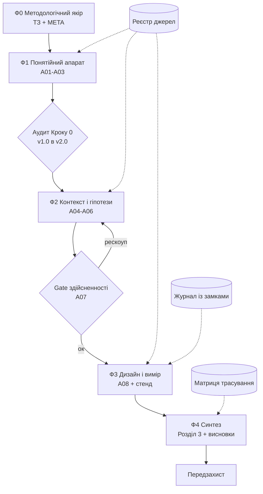

# 01 Конвеєр здобувача

> **Підпорядкування.** Цей документ — екземпляр `ПРОТОКОЛ — Ефективний дизайн нового
> проекту`. Аксіоми **О-1…О-5 вищі за цей файл**.
>
> **Виробнича лінія:** сировина → атомарні замітки → артефакти A01–A08 → текст роботи →
> захист. Пульт керування — [[MOC]].

---

## 1. Аксіоми, які діють без винятків

| | Аксіома | Що це означає особисто вам |
|---|---|---|
| **О-1** | Волт є субʼєктом, ШІ — інструмент | Claude не памʼятає нічого між сесіями. Єдина спадковість — волт. Кожна сесія починається з читання [[MOC]] і [[LOG — Журнал рішень]] |
| **О-2** | Форми знання маркуються явно | кожне твердження несе `[E]` / `[Em]` / `[Sp]` / `[OP]` / `[VL]`. **Зафіксована суперечність `[OP]` є науковим результатом** — [[05 META — Методологічна угода]], §4 |
| **О-3** | Онтологічна позиція — до першого рядка | обʼєкт, предмет, природа вимірів. Заповнюється в [[04 ТЗ — Технічне завдання]] |
| **О-4** | Контрприпущення обовʼязкове | для центральної гіпотези — **рівноправна альтернатива**, не критика |
| **О-5** | Рішення незворотні до скасування | кожне рішення — `Р-N` у [[LOG — Журнал рішень]] із датою й обґрунтуванням |

---

## 2. Масштаб — залежить від рівня роботи

| Рівень | Масштаб | Обсяг | Обовʼязкове |
|---|---|---|---|
| **Бакалавр** | **Midi** | 3–13 артефактів, 5–12 сесій | усі аксіоми + Фази 0–3 |
| **Магістр** | **Macro** | повний цикл | повний протокол, Фази 0–4 |
| **PhD** | **Macro + ≈10 циклів** | серія передреєстрованих ходів | кожен цикл документується окремо |

Ваш масштаб указано в [[02 Наукове завдання]]. Виконувати більше, ніж вимагає масштаб, —
не чеснота, а розповзання.

---

## 3. Схема конвеєра



**Контракт станції:** **вхід** (попередні артефакти) → **перетворення** → **Gate**
([[07 ПЗ — Процедура закриття]]) → **вихід** (артефакт + статус версії).

---

## 4. Фаза 0 — методологічний якір

**До Фази 1 не переходити.** Типовий час — 2 тижні.

Повний перелік блоків і три пастки формулювання обʼєкта, предмета й мети —
у [[04 ТЗ — Технічне завдання]].

### Два стани мети

| | Коли | Роль |
|---|---|---|
| **Мета робоча** | замикається в [[04 ТЗ — Технічне завдання]] на Фазі 0, з датою | **вимірювальна база для дельти** ([[07 ПЗ — Процедура закриття]], З-4) |
| **Мета фінальна** | формулюється на Фазі 4 з результатів | іде в анотацію й вступ |

Без робочої мети процедура закриття не працює: дельту нема від чого міряти. Розбіжність
між станами фіксується як `Р-N` і сама є результатом.

---

## 5. Фази й відповідність розділам роботи

| Фаза | Артефакти | Куди йде в тексті |
|---|---|---|
| **Ф1** Понятійний апарат і межа знань | A01 глосарій · A02 матриця понять · A03 карта межі знань | **Розділ 1** |
| **Ф2** Контекст і гіпотези | A04 контекст → вимоги · A05 гіпотези + контрприпущення · A06 карта загроз чинності | **Розділ 1–2** |
| **Gate** здійсненності | A07 | `Р-N (к)`; при провалі — рескоуп |
| **Ф3** Дизайн і вимір | [[11 A08 Дизайн дослідження]] · стенд · результати | **Розділ 2–3** |
| **Ф4** Синтез | розділ 3, висновки, анотація | **Розділ 3 + висновки** |

**Правило аудиту (Ф1).** Артефакт будується як `v1.0` → **аудит трьома контурами** →
`v2.0`. Масштабування без аудиту накопичує дефекти нелінійно.

**Правило порядку написання (Ф4).**
`Проблема → Лакуна → Мета → Матеріал → Висновки → Анотація → Назва`.
**Анотація пишеться останньою** — написана першою, вона описує те, чого ще не існує.

---

## 6. Три керуючі артефакти

| Артефакт | Питання | Ритм |
|---|---|---|
| [[MOC]] | *де я зараз* | читати **до** сесії, оновлювати **після** |
| [[LOG — Журнал рішень]] | *що я вирішив і чому* | після кожного рішення |
| [[Журнал дослідження]] | *що я передбачав і що виміряв* | щодня, коли працювали |

Перекриття немає в жодній точці: **стан / рішення / передбачення**. Старі записи
`LOG` і Журналу **не редагуються ніколи**.

---

## 7. Два наскрізні пояси

[[Реєстр джерел]] живить Ф1, Ф2 і Ф3 — основа заборони галюцинування.

**Матриця трасування** ведеться від Ф1 і зводиться на Ф4: кожне твердження синтезу цитує
конкретну атомарну замітку. Твердження без трасування у висновки не потрапляє.

---

## 8. Ролі й класи рішень

| Роль | Хто | Закриває |
|---|---|---|
| **Архітектор операційного шару** | **здобувач** | запис файлів · технічні `OQ` · `Р-N (о)`: бібліотека, розбиття даних, вигляд графіка |
| **Архітектор канону** | **керівник** | `Р-N (к)` — вісім зарезервованих класів |

**Зарезервовані `Р-N (к)`:** 1) тема, обʼєкт, предмет; 2) критерій завершення;
3) **baseline**; 4) рескоуп після Gate; 5) перехід фази; 6) статус `v-final`;
7) зміна умови спростування в замку; 8) опора на джерело рівня 4–5 як `[E]`.

**Принцип:** гейт тримає той, хто **не виграє від його проходження**.

Формат запису — [[LOG — Журнал рішень]].

---

## 9. Керуючий цикл сесії — інваріантний

```
START -> read MOC -> read LOG -> read GLOSSARY -> визначити фазу/крок
      -> генерація
      -> ПЗ (пʼять кроків)
      -> список файлів -> «Ок»
      -> write files -> update MOC -> update LOG -> верифікація каталогу
```

**Один крок — одне підтвердження — один файл.** Не скорочується.

---

## 10. Версіонування

`v1.0` побудовано · `v2.0` верифіковано після аудиту · `v-final` ратифіковано керівником.

Відсутність версіонування = неможливість відкату й відтворення.

---

## 11. Структура волту

**Файли верхнього рівня** — цифри `00`–`11` плюс шість керуючих без номера:
`MOC` · `LOG — Журнал рішень` · `Журнал дослідження` · `Реєстр джерел` · `GLOSSARY` ·
`OQ — Реєстр відкритих питань`.

**Робочі теки — літери A–H.** Створюєте самі; порядок створення — [[00 СТАРТ — прочитай першим]],
розділ «Розгортання тек».

```
A Понятійний апарат/      15-25 атомарних нот, одна ідея = один файл
B Контекст і гіпотези/     вимоги, гіпотези, контрприпущення, загрози чинності
C Модель і метрики/        метрики, модель оцінювання, протокол
D Експеримент/
  ├── data/raw            НЕ редагується ніколи
  ├── data/interim
  ├── data/processed
  ├── stend/              репозиторій Git — див. 09 Стенд, §3
  └── out/                результати з провенансом
E Синтез і текст/          розділи .md, потім компіляція у .docx
F Апробація/
  ├── Конференція-осінь/
  └── Конференція-весна/
G Артефакти/               зведені A01-A08
H Сесії/
  ├── Картки закриття/
  └── Чернетки/
```

> **Чому теки — літери, а файли — цифри.** Якби теки теж мали номери, у провіднику стояли б
> поруч `01 Конвеєр здобувача.md` і `01 Понятійний апарат/`. Літери знімають колізію
> остаточно: **цифра — завжди файл, літера — завжди тека**.

**Чого в розкладці навмисно немає:**

| Немає теки | Де це живе натомість |
|---|---|
| «Джерела» | [[Реєстр джерел]] — один файл; PDF зберігаються поза волтом |
| «Дані» окремо | `D Експеримент/data/` — дані невіддільні від експерименту |
| «Результати» окремо | `D Експеримент/out/` — результат невіддільний від прогону |
| «Звіти керівникові» | витяг із [[Журнал дослідження]]; окремий документ не створюється |

---

## 12. Критерій завершення

Фіксується в [[04 ТЗ — Технічне завдання]], блок 8. Робота завершена, коли всі артефакти
мають `v-final` або відкладені з обґрунтуванням, усі `OQ-N` закриті або відкладені з умовою
повторного відкриття, [[MOC]] зелений, а [[LOG — Журнал рішень]] містить фінальний запис
із POST-MORTEM.

---

## Звʼязки

[[00 СТАРТ — прочитай першим]] · [[MOC]] · [[02 Наукове завдання]] ·
[[03 Паспорт напряму]] · [[04 ТЗ — Технічне завдання]] · [[05 META — Методологічна угода]] ·
[[06 ІНСТРУКЦІЯ — Claude-проєкт]] · [[07 ПЗ — Процедура закриття]] ·
[[08 Календар віх і контрольних точок]] · [[09 Стенд — розгортання]] ·
[[11 A08 Дизайн дослідження]] · [[LOG — Журнал рішень]] · [[Журнал дослідження]] ·
[[Реєстр джерел]] · [[GLOSSARY]] · [[OQ — Реєстр відкритих питань]]
