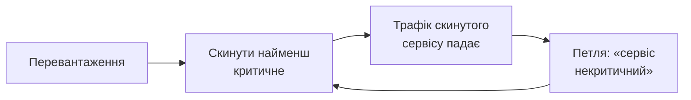

# 03 Паспорт напряму

> [[02 Наукове завдання]] каже, **що** робити. Цей файл — **звідки воно взялося, де межа
> й чого не робити**. Повертайтеся, коли зʼявиться спокуса «розширити тему».

---

## 1. Загальна картина

Мережа не може обслужити все. Під перевантаженням автономна петля мусить **щось скинути** —
і робить це за оцінкою критичності сервісів.

Це зріла інженерна практика: у системах жорсткого реального часу керована деградація
за важливістю задач розроблена давно. Але там **важливість задана статично** — інженером,
до запуску.

**У мережі під автономним управлінням критичність не статична.** Той самий сервіс критичний
під час аварії й другорядний у звичайний день. Отже петля мусить її **інферувати в рантаймі**.

---

## 2. Механізм — чому оцінка критичності самопідтверджується

Петля інферує критичність із поведінки. Але поведінку **вона сама й формує** своїми
скиданнями: скинутий сервіс перестає генерувати трафік — і виглядає ще менш критичним.

**Оцінка підтверджується наслідками рішення, яке на ній стояло.**

Друга складова: скидання **не локальне**. Сервіси залежні, і відмова поширюється каскадом.
Рішення треба ухвалити **швидше, ніж поширюється каскад** — і водночас утримати систему
на керованому боці переходу, за яким деградація стає обвалом.

---

## 3. Де саме межа знань

Три складові окремо зрілі, **сполука не закрита ніким**:

| | Складова | Стан у полі |
|---|---|---|
| **1** | керована деградація за важливістю | зріла — але зі **статичною** важливістю |
| **2** | каскадні відмови й самовідновлення як динамічний процес | змодельовано — але з **фіксованою** важливістю, описово, на абстрактних графах |
| **3** | місія-адаптивне керування | давня ідея — але **мережі бракує динамічного контексту** |

**Живий пробіл — сполука трьох умов одночасно:**
(i) політика **спряжена з каскадною динамікою**; (ii) діє на **інферованій** критичності;
(iii) **вкладається в часовий бюджет**.

**Ядро складності:** інференція критичності потребує часу, а каскад його не дає. І чим довше
петля інферує, тим більше даних вона отримує **від власних попередніх скидань**.

---

## 4. Дві страти критичності — і чому одна поза обсягом

**Найважливіший розділ паспорта.**

| Страта | Як задається | Що дає канал | Статус |
|---|---|---|---|
| **Оголошена** | норматив: клас пріоритету, профіль обслуговування, рантайм-підняття за індикацією сесії | **клас**, тобто межі, а не точку | **не фронтир** |
| **Інферована** | виводиться з поведінки, яку сама політика й формує | **нічого** — каналу до істинної втрати цінності немає | **фронтир** |

**Ваша робота — тільки друга страта.** Рішення керівника, ухвалене до видачі завдання.

**Чому це рішення, а не деталь.** Оголошена критичність **не є вимірюванням** — вона є
**декларацією**. Норматив не міряє втрату цінності від скидання сервісу; він її **заміщає**
класом. Механізм рантайм-підняття за індикацією сесії існує саме тому, що статичне
призначення виявляється хибним у надзвичайній ситуації — а коригувати можна лише **до
чогось**. Отже призначення й критичність — різні величини, і перше лише обмежує друге.

> **Заборонений дрейф.** Перенести роботу на оголошену страту — виглядає як прогрес: дані
> доступні, порівняння очевидне, результат виходить швидко. І це **вихід із фронтиру**.

---

## 5. Найтонше місце: похибка інференції не є шумом

Зрозумійте це до початку роботи — від цього залежить, чи взагалі щось буде виміряно.

Природний хід думки: «змоделюю інференцію критичності з похибкою, подивлюся, як політика
деградує зі зростанням похибки». Похибка моделюється як **незалежний випадковий шум**.

**Це приховає весь ефект.**

Похибка інференції **корелює з рішеннями політики**, бо політика формує дані, з яких
інференція навчається. Скинутий сервіс дає менше даних → інференція оцінює його гірше →
його скидають знову. Похибка **систематична й самопідтвердна**, а не випадкова.

**Наслідок для методики:** модель похибки з керованою кореляцією до рішень політики —
центральна частина стенда, а не деталь. Проба чутливості до цього вибору в кроці К11 —
**головна перевірка методики**.

**Очікуваний результат:** за незалежної похибки перевага інферованої критичності є; за
корельованої — зникає або суттєво меншає. Якщо це підтвердиться, ви виміряли, **скільки саме
коштує самопідтвердність** — і це головний результат роботи.

---

## 6. Ваше місце в загальній картині

| Рівень | Що робить |
|---|---|
| бакалавр | не береться: сполука трьох умов завелика для одного семестру |
| **Ви (магістр)** | будуєте методику оцінювання політик і міряєте, **як перевага залежить від похибки інференції та від часу рішення**; два режими каскаду |
| аспірант | шукає, чи існує політика, оптимальна рівномірно по класах каскаду, і за яких умов самопідтвердність принципово не усувна |

**Ваш результат потрібен програмі:** гілка інферованої критичності — **третій носій**
спільного апарату «похибка проти частки контакту з дійсністю».

---

## 7. Позиціювання новизни

**Що вже зайнято:** керована деградація зі статичною важливістю · моделі каскадних відмов
із фіксованою важливістю · місія-адаптивне керування як концепція.

**Що відкрито:** **сполука** — політика, одночасно спряжена з каскадом, на інферованій
критичності, у межах часового бюджету.

**Ваш внесок:** не політика, а **методика оцінювання політик** у цих умовах.

> **Обовʼязково для розділу 1:** показати, що виграш іде **саме від сполуки**, а не від
> однієї складової. Якщо перевага дається лише спряженням із каскадом — це вже зроблено;
> якщо лише інференцією — це задача якості інференції, тобто інший предмет.

Перевірка новизни виконується заново на Фазі 1 — [[10 Промти ШІ для першоджерел]], промт 4.

---

## 8. Контракт розмежування

| Суміжний | Спільне | **Ви НЕ розглядаєте** |
|---|---|---|
| **НД-8** (нереалізований трафіковий попит) | обидва навмисно погіршують якість обслуговування | ідентифікування попиту, варіацію заради пізнання, ємнісні рішення |
| **НД-4** (розрізнення передвісників нестабільності) | обидва працюють біля переходу | передвісники, критичне сповільнення, **виявлення** наближення переходу |
| **НД-9** (систематична похибка нерівномірності) | обидва мають вибірку, цензуровану власними рішеннями | нерівномірність розподілу, порівняння між групами користувачів |

> **З НД-8 — найтонше, бо технічна операція та сама.**
> Там погіршення якості є **актом пізнання**: петля навмисно псує, щоб дізнатися.
> У вас — **дією керування**: петля скидає, щоб система вижила.
> Однакова операція, різне призначення, різні критерії допустимості.
> **Ви не досліджуєте деградацію як інструмент пізнання** — навіть якщо помітите, що ваші
> скидання дають інформацію. Це предмет колеги.

> **З НД-4 — за роллю переходу.** Там близькість до переходу — **те, що виявляється**.
> У вас — **заданий параметр стенда**: приймаєте як вхід і питаєте, як від нього залежить
> політика. **Не будуйте детектор наближення переходу.**

---

## 9. Три спокуси

| Спокуса | Чому це вихід із теми |
|---|---|
| «візьму оголошену критичність — там є реальні дані» | вихід із фронтиру, §4 |
| «побудую кращу модель інференції критичності» | предмет — **оцінювання політик**, не якість інференції |
| «змоделюю похибку інференції як звичайний шум» | приховає весь ефект, §5; робота дасть красивий і порожній результат |

Третя спокуса найнебезпечніша, бо вона **не виглядає як спокуса** — вона виглядає як
стандартний методичний хід.

---

## 10. Що напрям дає програмі

**Перше:** кількісна ціна самопідтвердності в петлі керування — скільки виграшу зʼїдає
кореляція похибки інференції з рішеннями політики. Такого числа зараз немає.

**Друге:** третій носій спільного апарату програми. Якщо крива «похибка проти частки
контакту» має однакову форму у трьох різних джерелах обструкції — це свідчення про спільну
структуру, а не збіг.

Тому **негативний за знаком результат тут так само цінний**: він однаково дає число.

---

## Звʼязки

[[02 Наукове завдання]] · [[MOC]] · [[00 СТАРТ — прочитай першим]] ·
[[04 ТЗ — Технічне завдання]] · [[07 ПЗ — Процедура закриття]] ·
[[08 Календар віх і контрольних точок]] · [[11 A08 Дизайн дослідження]] ·
[[10 Промти ШІ для першоджерел]] · [[Реєстр джерел]] · [[GLOSSARY]] ·
[[OQ — Реєстр відкритих питань]]
